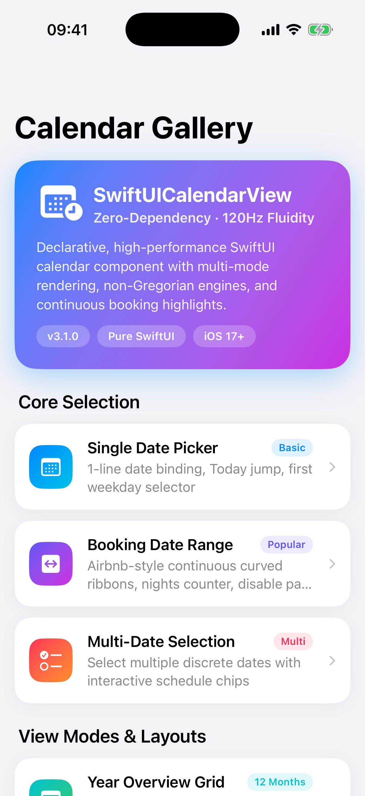
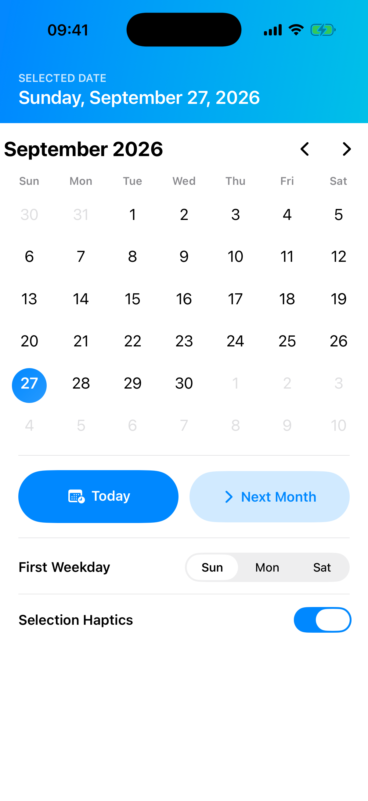
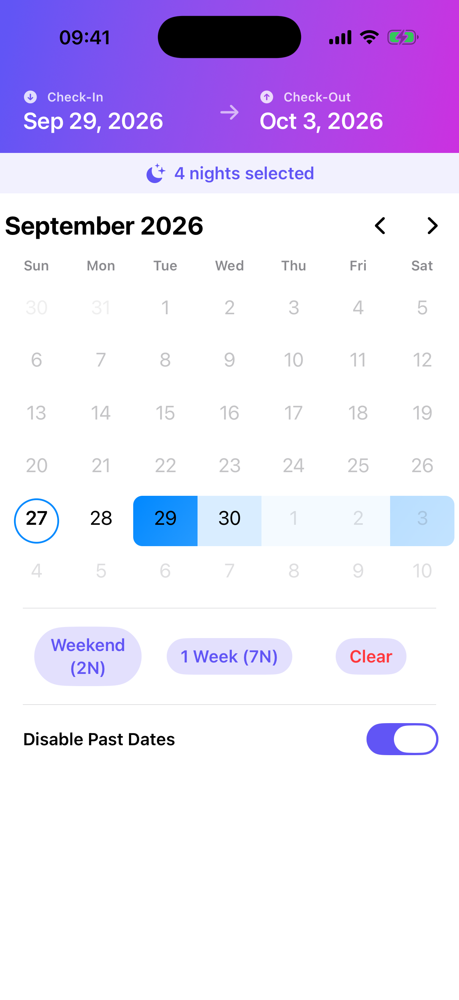
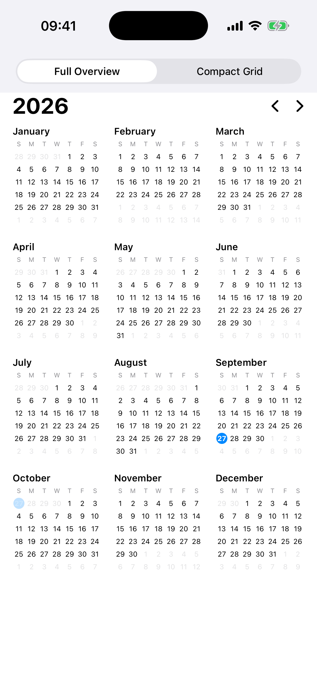
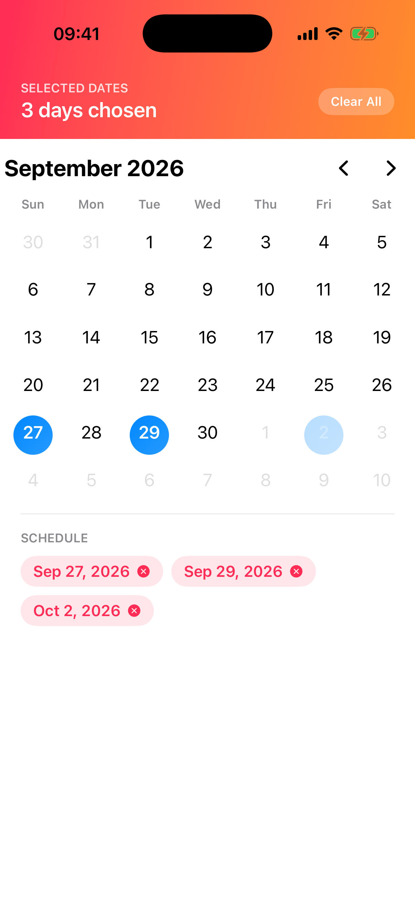
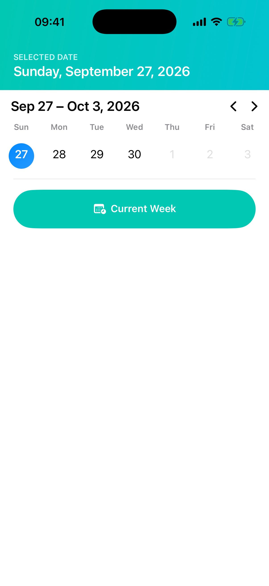
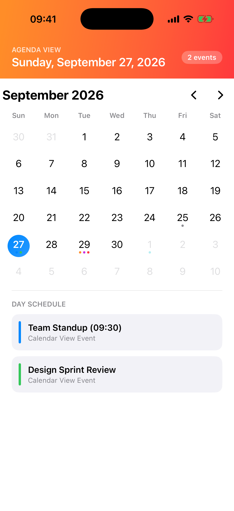
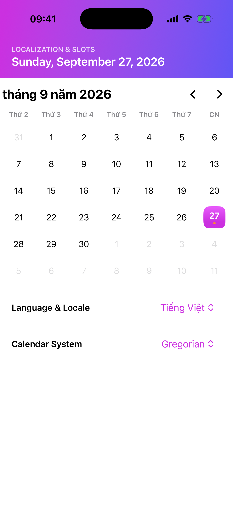

<p align="center">

<h1 align="center">SwiftUICalendarView 3.1</h1>
</p>

<p align="center">
<strong>The #1 Zero-Dependency, High-Performance Declarative Calendar for SwiftUI.</strong>
</p>

<p align="center">


<a href="LICENSE"></a>
<a href="https://github.com/iletai/SwiftUICalendarView/actions"></a>
</p>

---

<p align="center">
  &nbsp;
  &nbsp;
  &nbsp;
  
</p>

## Why SwiftUICalendarView 3.1?

SwiftUICalendarView is engineered from the ground up for modern SwiftUI. Built with `FastCalendarEngine` for 120fps ProMotion fluidity, zero third-party dependencies, multi-mode rendering (Month, Year, Week), non-Gregorian calendar support, fluid swipe gestures, and standard declarative ViewModifiers.

- **Zero Dependencies**: Pure SwiftUI & Foundation. No external runtime overhead (< 80KB binary footprint).
- **Multiple View Modes**: Native rendering for `.month`, `.year(.full)`, `.year(.compact)`, `.week`, and `.single` day modes.
- **Fluid Swipe Gestures**: Smooth horizontal swipe navigation with spring physics and haptic feedback.
- **1-Line Ergonomic Initializers**: Single date, booking date ranges, multi-date selections, and display-only agendas.
- **Continuous Range Highlight**: Native smooth connected bounding curves for hotel & flight booking ranges.
- **`FastCalendarEngine` O(1) Math**: Date comparisons and lookups powered by integer key hash math (`YYYYMMDD`), bypassing expensive `DateComponents` allocations per frame.
- **Fixed 42-Cell Matrix**: Deterministic 6×7 grid prevents height jumping and layout jitter across month switches.
- **Deep Localization & Calendar Systems**: Works natively with Gregorian, Buddhist (BE), Japanese (Reiwa), Islamic (Hijri), Hebrew, and Persian calendars.
- **Full VoiceOver Accessibility**: Accessible traits, dynamic date descriptions, and event count announcements out of the box.

---

## Requirements

| Platform | Minimum Version | Swift |
| :--- | :--- | :--- |
| **iOS** | 17.0+ | 5.9+ |
| **macOS** | 13.0+ | 5.9+ |
| **visionOS** | 1.0+ | 5.9+ |
| **watchOS** | 10.0+ | 5.9+ |
| **tvOS** | 17.0+ | 5.9+ |

---

## Installation

### Swift Package Manager (SPM)

In Xcode, select **File > Add Package Dependencies...** and enter:

```
https://github.com/iletai/SwiftUICalendarView.git
```

Or add it to your `Package.swift`:

```swift
dependencies: [
    .package(url: "https://github.com/iletai/SwiftUICalendarView.git", from: "3.1.0")
],
targets: [
    .target(name: "YourTarget", dependencies: ["CalendarView"])
]
```

### CocoaPods

Add to your `Podfile`:

```ruby
pod 'SwiftUICalendarView', '~> 3.1'
```

---

## Quick Start

### 1. Single Date Picker

```swift
import SwiftUI
import CalendarView

struct SinglePickerDemo: View {
    @State private var selectedDate = Date()

    var body: some View {
        CalendarView(selection: $selectedDate)
    }
}
```

### 2. Booking Range Picker (Continuous Highlight)

```swift
struct BookingRangeDemo: View {
    @State private var dateRange: ClosedRange<Date>? = nil

    var body: some View {
        CalendarView(selection: $dateRange)
    }
}
```

### 3. Multi-Date Selection

```swift
struct MultiSelectionDemo: View {
    @State private var selectedDates = Set<Date>()

    var body: some View {
        CalendarView(selection: $selectedDates)
    }
}
```

### 4. Display-Only Agenda / Read-Only Calendar

```swift
struct AgendaCalendarDemo: View {
    @State private var displayDate = Date()

    var body: some View {
        CalendarView(displayDate: $displayDate)
    }
}
```

---

## View Modes

Switch calendar display mode with `.calendarViewMode()`:

```swift
// Month grid (default)
CalendarView(selection: $selectedDate)
    .calendarViewMode(.month)

// Year view (12-month grid with auto-scroll to current month)
CalendarView(selection: $selectedDate)
    .calendarViewMode(.year(.full))    // with weekday symbols
    .calendarViewMode(.year(.compact)) // day numbers only

// Week view (single 7-day row with week navigation)
CalendarView(selection: $selectedDate)
    .calendarViewMode(.week)

// Single day view (large day card with event list)
CalendarView(selection: $selectedDate)
    .calendarViewMode(.single)
```

---

## Declarative ViewModifiers

Configure calendars cleanly using SwiftUI's environment and modifier system:

```swift
CalendarView(selection: $selectedDate)
    // 1. Set Calendar View Mode (.month, .week, .year)
    .calendarViewMode(.month)

    // 2. Multi-color Event Indicators
    .calendarEvents([
        Date(): [
            CalendarEvent(date: Date(), color: .blue, title: "Team Sync"),
            CalendarEvent(date: Date(), color: .red, title: "Release 3.1")
        ]
    ])

    // 3. Disable Specific Dates / Weekends / Past Dates
    .calendarDisabledDates { date in
        Calendar.current.isDateInWeekend(date)
    }

    // 4. Override First Day of the Week
    .calendarFirstWeekday(.monday)

    // 5. Locale & Language Customization
    .calendarLocale(Locale(identifier: "vi_VN"))

    // 6. Enable / Disable Selection Haptics (iOS)
    .calendarHapticsEnabled(true)
```

---

## Custom Slot Builders

Customize the day cell, month header, or weekday header while retaining full engine performance and selection state:

### Custom Day Cell Builder

```swift
CalendarView(selection: $selectedDate)
    .calendarDayCell { state in
        VStack(spacing: 2) {
            Text("\(state.dayNumber)")
                .font(.system(size: 15, weight: state.isSelected ? .bold : .regular))
                .foregroundColor(state.isSelected ? .white : (state.isCurrentMonth ? .primary : .secondary))

            if !state.events.isEmpty {
                Circle()
                    .fill(Color.orange)
                    .frame(width: 4, height: 4)
            }
        }
        .frame(height: 38)
        .frame(maxWidth: .infinity)
        .background(
            RoundedRectangle(cornerRadius: 8)
                .fill(state.isSelected ? Color.blue : Color.clear)
        )
    }
```

### Custom Month Header & Weekday Header

```swift
CalendarView(selection: $selectedDate)
    .calendarHeader { matrix, onPrevious, onNext in
        HStack {
            Text(matrix.monthTitle)
                .font(.headline)
            Spacer()
            Button(action: onPrevious) { Image(systemName: "arrow.left") }
            Button(action: onNext) { Image(systemName: "arrow.right") }
        }
        .padding(.horizontal)
    }
    .calendarWeekdayHeader { calendar in
        HStack {
            ForEach(calendar.shortStandaloneWeekdaySymbols, id: \.self) { symbol in
                Text(symbol.prefix(1))
                    .font(.caption2.bold())
                    .frame(maxWidth: .infinity)
            }
        }
    }
```

---

## Visual Showcase Gallery

| Gallery Hub | Single Date Picker | Booking Date Range | Year 12-Month Grid |
| :---: | :---: | :---: | :---: |
|  |  |  |  |

| Multi-Date Selection | 7-Day Week Strip | Event Agenda Calendar | Non-Gregorian & Custom |
| :---: | :---: | :---: | :---: |
|  |  |  |  |

---

## Example App

An interactive iOS showcase app is included under `Example/`:

```bash
# Open in Xcode to run on Simulator or preview in Canvas
open Example/CalendarExample.xcodeproj
```

*(You can also regenerate the Xcode project at any time via `cd Example && xcodegen generate`)*

---

## Contributing

Contributions, bug reports, and feature requests are welcome!
1. Fork the project repository.
2. Create your feature branch (`git checkout -b feature/amazing-feature`).
3. Ensure all tests pass (`swift test`).
4. Commit your changes (`git commit -m 'feat: add amazing feature'`).
5. Push to the branch and open a Pull Request.

---

## License

SwiftUICalendarView is released under the **MIT License**. See [LICENSE](LICENSE) for details.
