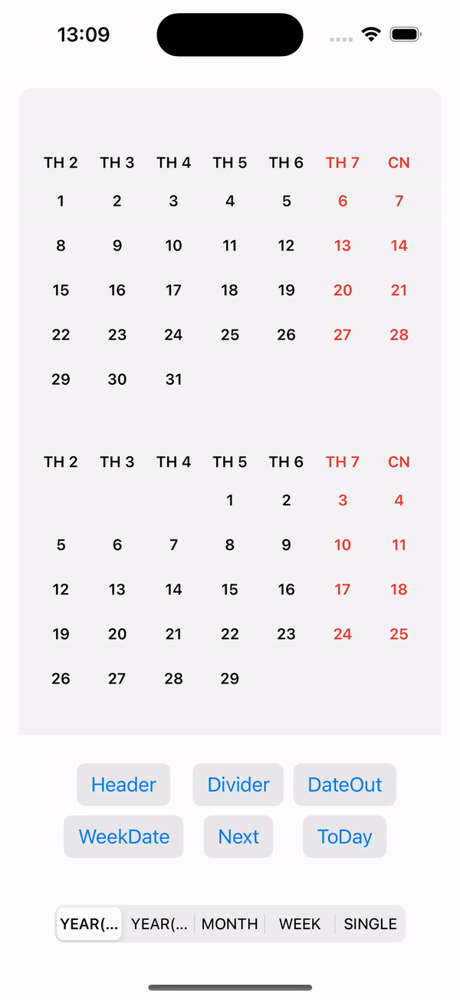

<p align="center">

<h1 align="center">Calendar For SwiftUI</h1>
</p>

<p align="center">
<a aria-label="Follow Me on Instagram" href="https://www.instagram.com/tai.lqt" target="_blank">
    
</a>
</p>

> [!NOTE]
> SwiftUI is a component for creating a calendar view with SwiftUI Framework.
> Build a Calendar By Pure SwiftUI using native Calendar and Date APIs. SwiftUICalendarView is a Swift Package for building and displaying a simple calendar interface in SwiftUI. This library provides an easy way to integrate a calendar into your app.

<p align="center">

</p>

## SwiftUICalendarView


[](LICENSE)
[](https://github.com/iletai/SwiftUICalendarView/actions/workflows/build_master.yml)

## Requirements

> [!IMPORTANT]
> | **Platforms** | **Minimum Swift Version** |
> |:----------|:----------|
> | iOS 17+ | 5.9 |

## Installation

### Swift Package Manager

To integrate SwiftUICalendarView into your project, add the GitHub URL to the dependencies section in your Package.swift file:

```swift
dependencies: [
    .package(url: "https://github.com/iletai/SwiftUICalendarView.git", from: "v2.0.0"),
],
targets: [
    .target(name: "YourTarget", dependencies: ["CalendarView"]),
]
```

### CocoaPods

CocoaPods is a dependency manager for Swift and Objective-C Cocoa projects that helps to scale them elegantly.

[Installation steps](https://cocoapods.org/pods/SwiftUICalendarView):

- Install CocoaPods 1.10.0 (or later)
- Add CocoaPods dependency into your `Podfile`

```shell
target 'MyApp' do
pod 'SwiftUICalendarView'
end
```

## Feature Support

- Calendar Mode: Week, Month, Year (Full & Compact), Single
- First WeekDay
- Show Date Out
- Pin Header Calendar
- Allow Custom Owner Calendar Date View
- Highlight Today
- Drag Direction & Mode Callbacks
- Calendar Locale
- Background Customization
- Row & Column Spacing
- Divider Support

## Usable Example Calendar View

> [!WARNING]
> To avoid interfering with the Observable reload mechanism in SwiftUI,
> let the application control reloads using `@State`, `@StateObject`, or `Observer` directly.

```swift
import SwiftUI
import CalendarView

struct ContentView: View {
    @State var isShowHeader = false
    @State var isShowDateOut = false
    @State var firstWeekDate = 1
    @State var viewMode = CalendarViewMode.year
    @State private var selectedDate = Date()
    @State var listSelectedDate = [Date]()

    var body: some View {
        VStack {
            CalendarView(
                date: selectedDate
                , dateView: { date in
                    VStack {
                        Text(date.dayName)
                            .font(.footnote)
                            .fontWeight(.semibold)
                            .foregroundColor(
                                Calendar.current.isDateInWeekend(date) ? .red : .black
                            )
                    }
                    .frame(maxWidth: .infinity)
                    .frame(height: 30)
                    .background(listSelectedDate.contains(date) ? .cyan : .clear)
                }, headerView: { date in
                    VStack {
                        Text(date.weekDayShortName)
                            .font(.footnote)
                            .fontWeight(.bold)
                            .foregroundColor(
                                Calendar.current.isDateInWeekend(date) ? .red : .black
                            )
                    }
                }, dateOutView: { date in
                    Text(DateFormatter.day.string(from: date))
                        .font(.footnote)
                        .foregroundColor(.gray)
                },
                onSelectedDate: onSelectedDate
            )
```

## Customizing the Interface

You can customize the calendar's interface using properties like accentColor, selectedDateColor, and disabledDateColor:

```swift
            .enableHeader(isShowHeader)
            .enableDateOut(isShowDateOut)
            .firstWeekDay(firstWeekDate)
            .calendarLocale(Locale(identifier: "vi"))
            .enablePinnedView(.sectionHeaders)
            .setViewMode(viewMode)
            .rowsSpacing(0)
            .columnSpacing(0)
            .backgroundCalendar(.visible(20, .gray.opacity(0.3)))
            .onDraggingEnded { direction, mode in
                if direction == .forward {
                    selectedDate = Calendar.current.date(
                        byAdding: mode == .week ? .weekOfYear : .month,
                        value: 1,
                        to: selectedDate
                    ) ?? selectedDate
                }
            }
```

## Migration Guide

### Migrating from v1.x to v2.0

#### SwiftDate Dependency Removed

The `SwiftDate` dependency has been removed. Use native `Calendar` and `Date` APIs instead:

```swift
// Before (SwiftDate)
import SwiftDate
selectedDate = selectedDate.nextWeekday(.friday)

// After (native)
let nextFriday = Calendar.current.nextDate(
    after: selectedDate,
    matching: DateComponents(weekday: 6),
    matchingPolicy: .nextTime
)
selectedDate = nextFriday ?? selectedDate
```

#### Renamed APIs

The following APIs have been renamed. Deprecated aliases are provided for backward compatibility:

| Old Name | New Name |
|:---------|:---------|
| `calendarLocate(locale:)` | `calendarLocale(_:)` |
| `enablePinedView(_:)` | `enablePinnedView(_:)` |
| `hightLightToDayView(_:_:)` | `highlightTodayView(_:_:)` |
| `withRounderConner(_:)` | `withRoundedCorner(_:)` |
| `enableHighlightToDay(_:)` | `enableHighlightToday(_:)` |

## Example

> [!NOTE]
> For example using this repository, please help to see more at: <https://github.com/iletai/SwiftUICalendarView/tree/master/CalendarExampleView>

If you find a bug or have a way to improve the library, create an Issue or propose a Pull Request. We welcome contributions from the community.

## License

SwiftUICalendarView is released under the MIT License. See details in LICENSE.
